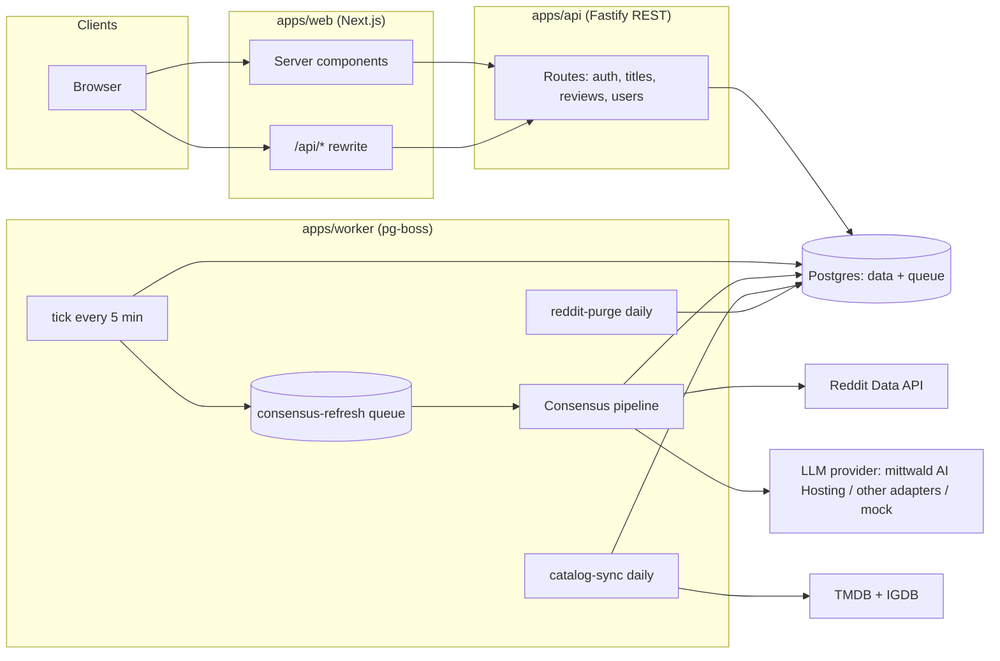

# Verdict: product and architecture plan

Verdict is a review site for movies, TV and games. Every title carries two independent scores:

| Score | Scale | Source | What it answers |
|---|---|---|---|
| **Reddit consensus** | 0-100 | AI-labeled Reddit discussion, scored in code | "What do people who talk about this online think?" |
| **User score** | 1-10 | Ratings and written reviews from Verdict members | "What do reviewers here think?" |

They are never blended. When they disagree, the gap is itself useful (a game Reddit hates for its monetization that players still rate highly, for example).

## Decisions

1. **The model labels, the code scores.** The LLM reads comments and returns a sentiment plus aspect tags for each one. The 0-100 score, confidence and pros/cons shares come from deterministic math over those labels. Scores are reproducible, auditable (every label is stored), and can be recomputed without another LLM call. Prompt injection inside a comment can at worst flip that one comment's label.
2. **mittwald AI Hosting is the primary AI provider, behind a swappable interface.** The analyzer depends on a one-method interface (`generateJson`). `LLM_PROVIDER=mittwald` calls mittwald's OpenAI-compatible endpoint, using an API key from mStudio. Other adapters: any OpenAI-compatible server (LM Studio, Ollama, vLLM, Mistral), MindStudio, Anthropic (Claude), and an offline mock. Switching providers means changing one env var.
3. **Postgres is the only stateful dependency.** App data, search (pg_trgm) and the job queue (pg-boss) all live there. Redis can come later if caching needs it.
4. **Separate API server.** The REST API (Fastify) is independent of the web app, so a mobile app or third-party clients can use it later. The web app calls it server-side for SSR and through a same-origin `/api` rewrite from the browser, which keeps the session cookie first-party and avoids CORS.
5. **The database decides what is due.** `titles.consensus_next_at` is the single schedule. The worker's 5-minute tick turns due rows into jobs, and the API's "refresh now" just sets that column. The API never talks to the queue.

## Architecture

### Repository layout

| Path | Role |
|---|---|
| `apps/web` | Next.js 16 App Router. Pages: home, browse by kind, title detail, search, sign in/up, profile |
| `apps/api` | Fastify 5 REST API. Sessions, reviews, votes, reports, titles, consensus |
| `apps/worker` | pg-boss worker: consensus refresh, scheduler tick, Reddit retention purge, catalog sync. Also `seed` and `run-once` |
| `packages/core` | Domain logic: Reddit client and discovery, comment filtering, LLM adapters, prompts, scoring, pipeline, TMDB/IGDB clients |
| `packages/db` | Drizzle schema, migrations, connection |
| `packages/shared` | Request schemas (zod) and response types shared by API and web |

## Consensus pipeline

Implemented in `packages/core/src/pipeline.ts`. One run per title:

1. **Discover threads.** Search the per-kind default subreddits (`movies`, `flicks`, `TrueFilm` / `television`, `TrueTelevision` / `Games`, `gaming`, `patientgamers`) plus title-specific subs from `titles.reddit_config` with `title:"<name>"`. Rank each result by name match, engagement and opinion markers ("Official Discussion", "Review Thread", "just finished"). Penalize trailers, casting news, box office, posts from more than two weeks before release, and posts naming a different year (remakes). Keep up to 6 threads.
2. **Harvest.** Top-level comments sorted by top, up to 100 per thread.
3. **Filter.** Drop bots, AutoModerator, stickied or mod-distinguished comments, deleted and removed comments, low-signal replies ("lol"), score below 2, and exact duplicates. Keep **one comment per author per title** (the highest scored). Sample round-robin across threads, up to 200 comments.
4. **Label (LLM, batched 40 at a time).** For each comment: `positive | mixed | negative | off_topic`, praised and criticized aspects from a fixed per-kind vocabulary (`packages/core/src/analysis/aspects.ts`), and a spoiler flag. The output is schema-constrained, and ids the model invents are dropped.
5. **Score (code).**
   - Weight per comment: `1 + log10(1 + upvotes)`, so a 5,000-upvote comment counts about 4.7 times a 1-upvote one.
   - Cap any single thread's share of total weight: 85% with 2 threads, 70% with 3, 55% with 4, 50% from 5 up. One viral thread can't define the result, and a 7-comment thread can't outvote a 28-comment one.
   - **Score** = (positive + 0.5 × mixed) / (positive + mixed + negative) × 100, with off-topic comments excluded.
   - **Controversy** = 1 − |positive − negative| / (positive + negative).
   - **Confidence** uses the effective sample size (Σw)²/Σw². Low below 12 (or fewer than 15 opinions), medium below 50, high at 50 or above.
   - **Label:** ≥85 Widely loved, ≥70 Well liked, 40-69 with controversy ≥0.6 Divisive, ≥55 Mostly positive, ≥40 Mixed, ≥25 Mostly negative, below that Panned.
   - Pros and cons are aspects mentioned in at least 5% of the weighted opinions, top 5 each.
   - Quotes: up to four spoiler-free comments, roughly proportional to the breakdown. Strongest dissent is always included when negatives are 8% or more. Picks are spread across threads, and near-duplicates are skipped.
6. **Summarize (LLM, one call).** It receives the computed stats and the 40 highest-weight spoiler-free comments, and returns a 2-3 sentence summary plus one phrase per listed aspect. It is told to match the tone of the numbers and never to state the score.
7. **Persist.** A new `consensus_snapshots` row (score history is kept), per-comment labels in `comment_labels`, and denormalized score columns on `titles`. Fewer than 10 opinionated comments publishes nothing and schedules a retry.

**Refresh cadence** (`nextRefreshAt`): unreleased every 3 days. First 2 weeks after release every 12h. Up to 60 days every 2 days. Up to 1 year every 14 days. After that every 60 days.

**Provenance on every snapshot:** provider, model, prompt version, sample size, thread list. The UI shows all of it under the panel.

## AI provider

| `LLM_PROVIDER` | Use it for | Setup |
|---|---|---|
| `mittwald` | **Production default.** mittwald AI Hosting, managed in mStudio | `MITTWALD_API_KEY` (created in mStudio). Optional: `MITTWALD_MODEL` (default `gpt-oss-120b`), `LLM_REASONING_EFFORT` |
| `mock` | Local dev, CI, demos | Nothing. Lexicon-based; never use it on real data |
| `openai-compatible` | LM Studio or any hosted OpenAI-style API | `LLM_BASE_URL` (LM Studio: `http://localhost:1234/v1`), `LLM_MODEL`, optional `LLM_API_KEY` |
| `mindstudio` | Running the analysis as a MindStudio agent | See below |
| `anthropic` | Claude via the official SDK, with structured outputs and server-side refusal fallbacks | `ANTHROPIC_API_KEY`, `ANTHROPIC_MODEL` (default `claude-opus-5-5`), `ANTHROPIC_EFFORT` (default `low`) |

**mittwald AI Hosting setup.**

1. In mStudio, open AI Hosting and create an API key.
2. Set `LLM_PROVIDER=mittwald` and `MITTWALD_API_KEY`.
3. Run `pnpm consensus:run <slug>` on one title and read the result before turning the worker loose.

| Setting | What it does |
|---|---|
| Endpoint | `https://llm.aihosting.mittwald.de/v1/chat/completions`, Bearer auth |
| `MITTWALD_MODEL` | Model choice. Models in mittwald's docs (Nov 2026): `gpt-oss-120b` (131k context, the default; strongest reasoning of the three), `Qwen3.6-35B-A3B-FP8` (256k), `Ministral-3-14B-Instruct-2512` (262k, smaller and faster). `GET /v1/models` with your key returns the current list |
| `LLM_REASONING_EFFORT` | Sent as `reasoning_effort` for gpt-oss. `low` is usually enough for labeling. Leave it unset if the server rejects the field |
| `LLM_JSON_MODE` | The adapter starts with `response_format: json_schema` (constrained decoding). If the server rejects that with a 400 naming the response format, it steps down to `json_object`, then to prompt-only, and remembers the working mode. Output is validated against the zod schema in every mode, and invalid JSON is retried |
| `LLM_BATCH_SIZE`, `LLM_CONCURRENCY` | Comments per labeling call (default 40) and parallel calls (default 3). Lower them if you see 429s, or if a smaller model starts mislabeling comment ids in big batches |

**Not verified yet.** This sandbox's network policy blocks both mittwald's API and its developer docs, so the adapter is covered by unit tests against simulated responses only. Unknowns to settle on the first real run:
- Which JSON mode the endpoint accepts.
- Rate limits and pricing for your plan.
- mittwald's data-processing terms for prompts (relevant because Reddit text is sent to the model).

**MindStudio setup** (only if you switch to it). MindStudio runs agents you build in its editor rather than exposing a raw completion endpoint.

1. Create an agent whose Start block declares three launch variables: `system`, `prompt`, `json_schema`.
2. Add a Generate Text block that uses `{{system}}` as the system message. The user message should be `{{prompt}}`, followed by "Respond with JSON matching: `{{json_schema}}`".
3. End the workflow by returning that block's output.
4. Set `MINDSTUDIO_API_KEY`, `MINDSTUDIO_APP_ID` and, optionally, `MINDSTUDIO_WORKFLOW`.

The adapter posts to `MINDSTUDIO_RUN_URL` (default `https://api.mindstudio.ai/developer/v2/apps/run`). It reads `result` (or `output`) from the response and validates it against the schema. MindStudio's public docs show both `apps/run` with `appId` and `agents/run` paths. Confirm against your workspace; the URL is configurable.

**Cost estimate.** These are estimates, not measurements. One refresh is about 200 comments, roughly 24k input and 5.5k output tokens across 5 labeling calls and 1 summary call, before thinking tokens.

| Model | Price (in / out per M tokens) | Per refresh | ~5,000 refreshes/month |
|---|---|---|---|
| Claude Opus 5.5 | $4 / $20 | ~$0.21 | ~$1,050 |
| Claude Haiku 5.5 | $0.10 / $0.50 | ~$0.005 | ~$25 |
| LM Studio (local) | hardware only | 0 | 0, but throughput-bound |
| mittwald AI Hosting | per your mStudio plan | not published in the docs I could reach | check mStudio |

5,000 refreshes/month is roughly what 2,000 tracked titles generate on the cadence above. **Recommendation:** before launch, hand-label 300 real comments and measure each mittwald model's labeling agreement against that set. Start with `gpt-oss-120b`, and switch labeling to `Ministral-3-14B-Instruct-2512` only if it scores within a few points. Non-urgent back-catalog refreshes can go through Anthropic's Message Batches API at 50% off.

## Reddit access and compliance (biggest risk)

- **Terms.** Reddit's Data API is free only for non-commercial use, at 100 queries per minute per OAuth client. Commercial use requires Reddit's approval and an agreement, with pricing at Reddit's discretion. Reports in 2026 also say self-serve access has tightened. **If Verdict will carry ads, affiliate links or subscriptions, get written approval from Reddit before launch.** Re-check Reddit's current Data API Terms and Developer Terms yourself; third-party summaries disagree on the details.
- **What we store.**
  - Usernames: never stored. Only a truncated SHA-256 is kept, used to cap one author's weight.
  - Raw comment text: nulled after `REDDIT_RETENTION_DAYS` (default 30) by the daily purge.
  - Quotes: only the current snapshot keeps quoted text, and every quote links to its source. Older snapshots keep numbers only.
  - Labels and scores: kept.
- **Still to build:** honoring deletions. Before showing a quote, periodically re-check quoted comment ids via `/api/info` and drop any that were deleted or removed.
- **Request budget.** A refresh costs about 8 searches plus up to 6 comment fetches, roughly 14 requests. 100 QPM caps us near 7 refreshes per minute, about 10k per day: plenty for launch. The client pauses on the `X-Ratelimit-*` headers and backs off on 429. Keep `CONSENSUS_CONCURRENCY` low because the budget is per OAuth client, not per process.
- **If access is denied or too expensive.** The pipeline depends on the `RedditSource` interface, so other discussion sources can slot in without touching scoring. Candidates: Steam user reviews for games, which have a public review endpoint. YouTube comments, through YouTube's Data API. Licensed critic data.

## User reviews

- One review per user per title, as an upsert at `PUT /titles/:slug/reviews/mine`. Ratings are 1-10, with a headline, a body of 20-10,000 characters, and a spoiler flag that blurs the text until clicked.
- Rating aggregates (`user_rating_sum` and `user_rating_count` on `titles`) are updated in the same transaction as every create, edit, delete or auto-hide, so list pages never aggregate on read.
- "Helpful" votes toggle and are unique per user, and you can't vote on your own review. Five distinct reports auto-hide a review pending moderation.
- "Top rated" lists use a Bayesian average, (5 × 6.5 + Σratings) / (5 + n), so a single 10/10 can't top the chart.
- **Before launch:**
  - Require email verification before a review counts toward the score.
  - Build an admin moderation queue for hidden reviews.
  - Add review-bombing detection: flag a title when its rating velocity spikes against its baseline, and temporarily exclude reviews from accounts under 7 days old.

## API

Base URL `http://localhost:4000` (or `/api` through the web app). JSON in and out. Errors use the shape `{ error, message, details? }`.

| Method | Path | Auth | Purpose |
|---|---|---|---|
| GET | `/health` | | Liveness |
| POST | `/auth/register` | | Create account and start a session (httpOnly cookie) |
| POST | `/auth/login` | | Start a session |
| POST | `/auth/logout` | | End the session |
| GET | `/auth/me` | user | Current user |
| GET | `/titles?kind&sort&page&pageSize` | | `sort`: `trending`, `top` (Bayesian user score), `consensus`, `new` |
| GET | `/search?q=` | | Fuzzy title search (trigram) |
| GET | `/titles/:slug` | | Title detail plus rating histogram |
| GET | `/titles/:slug/consensus` | | Current consensus with history (404 `no_consensus` if never analyzed) |
| POST | `/titles/:slug/consensus/refresh` | admin | Mark due now; the worker picks it up within 5 minutes |
| GET | `/titles/:slug/reviews?sort&page` | | Reviews, plus `mine` when signed in |
| PUT | `/titles/:slug/reviews/mine` | user | Create or replace your review |
| DELETE | `/titles/:slug/reviews/mine` | user | Delete your review |
| POST | `/reviews/:id/helpful` | user | Toggle a helpful vote |
| POST | `/reviews/:id/report` | user | Report (`spam`, `abuse`, `spoilers`, `off_topic`, `other`) |
| GET | `/reviews/recent?limit` | | Latest spoiler-free reviews |
| GET | `/users/:username` | | Public profile and reviews |

## Security

| Area | Measure |
|---|---|
| Passwords | scrypt (N=2^15) from `node:crypto`; the parameters are stored in the hash so they can be raised later. Login runs a dummy hash for unknown emails so timing doesn't leak which emails exist |
| Sessions | 256-bit random tokens; only their SHA-256 is stored. Cookie is httpOnly, SameSite=Lax, Secure in production, 30-day expiry |
| CSRF | SameSite=Lax, plus an Origin allowlist on every state-changing request |
| Abuse | Rate limits: 300/min global, 10/min on auth, 20/min on review writes. Zod validation on every input. 64 KB body limit |
| Prompt injection | Comments are wrapped in tags and marked untrusted. Output is schema-constrained, invented ids are discarded, and the score is computed in code |

## Deployment

- **Web:** Vercel or any Node host, with `API_INTERNAL_URL` pointing at the API's private address.
- **API and worker:** containers (Fly.io, Render, Railway, ECS). The API is stateless and scales horizontally. Worker throughput is bound by the Reddit request budget, not CPU, so one or two instances are enough.
- **Postgres:** managed (Neon, RDS, Supabase). pg-boss needs session-level features (advisory locks, LISTEN), so point the worker at a **direct, non-transaction-pooled** connection. The API can go through PgBouncer.
- **Caching (next step):** anonymous title pages are identical for everyone. Serve them from the CDN with about 60s revalidation, and move the per-viewer parts (`mine`, `viewerFoundHelpful`) to a client-side fetch.

## Roadmap

**Phase 0, this repo (done):**
- Working vertical slice: catalog, consensus pipeline, user reviews, auth, web UI.
- Runs offline on fictional fixture titles with synthetic Reddit threads.
- 32 tests, covering unit logic, provider adapters and API integration.

**Phase 1, launch readiness:**
- Reddit approval and production credentials.
- Live TMDB/IGDB sync. The clients are written but untested against live keys.
- First live mittwald run, then the model selection eval (300 labeled comments).
- Email verification and password reset.
- Moderation UI, deletion re-check for quotes, CDN caching.
- Structured logs to OpenTelemetry; deploy pipeline.

**Phase 2, depth:**
- Per-season and per-episode TV consensus; per-platform game consensus (a bad PC port vs a fine console version).
- A "Reddit vs users" divergence feed.
- Watchlists, follows and notifications.
- Meilisearch for search, an image proxy, an admin dashboard for pipeline health.

**Phase 3, reach:**
- More discussion sources.
- A public API.
- A mobile app on the same REST API.

## Assumptions to confirm

- **mittwald plan limits.** Rate limits and pricing on your mStudio plan decide `LLM_CONCURRENCY` and how many titles can be tracked per month.
- **Monetization plans.** They decide which Reddit, TMDB and IGDB commercial terms apply.
- **The name.** "Verdict" is a placeholder.
